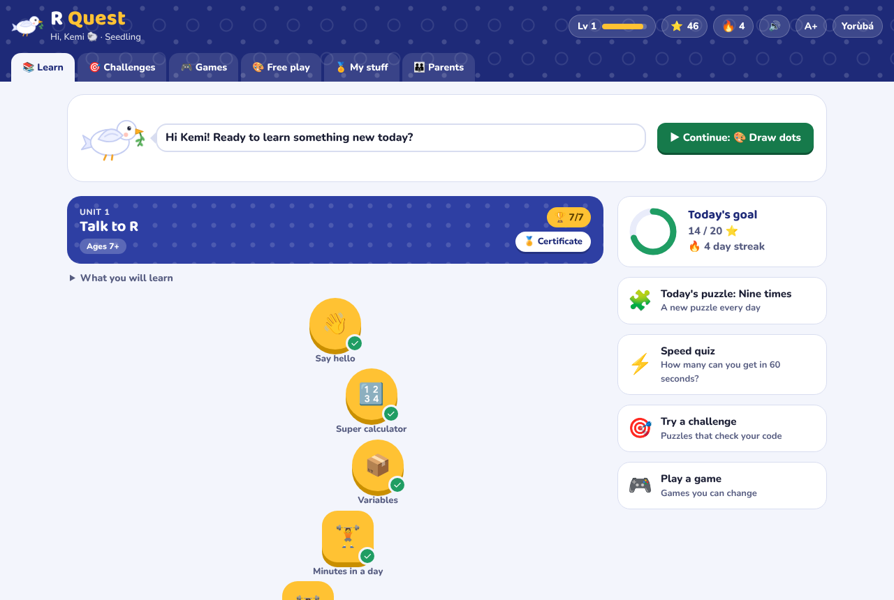
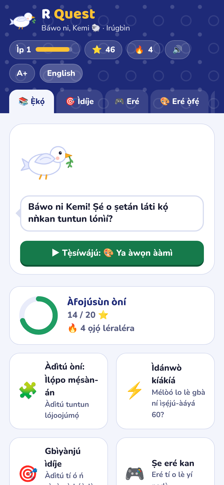
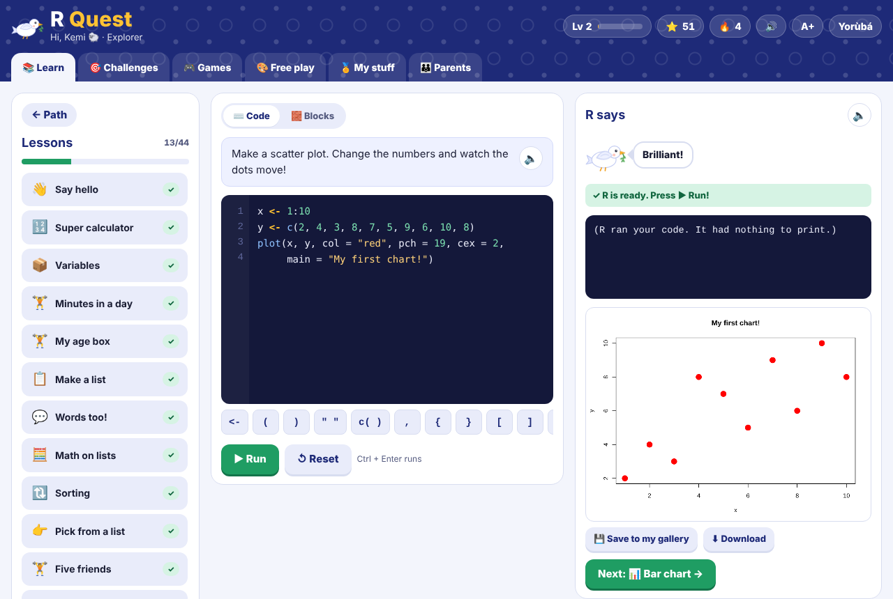
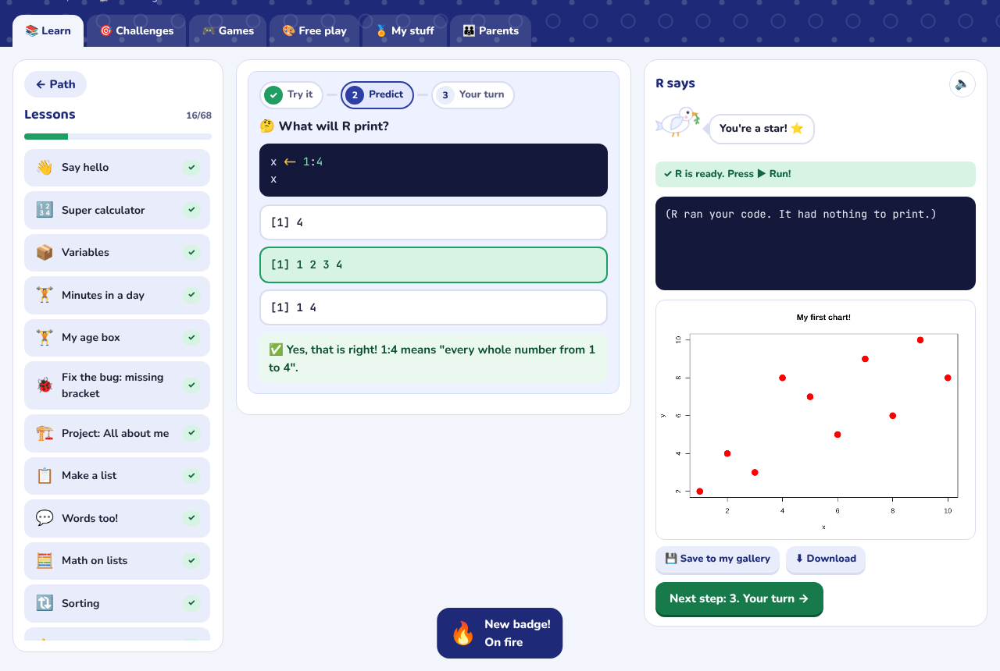
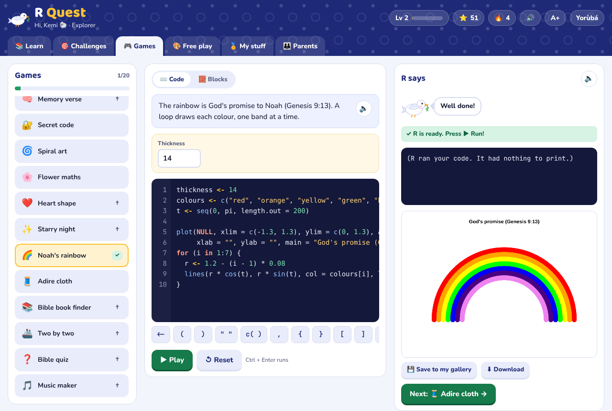
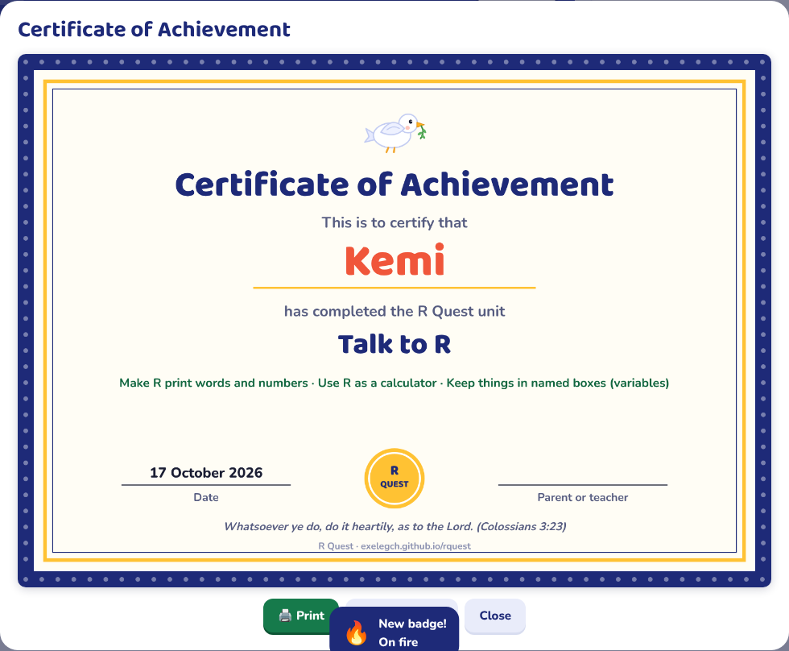
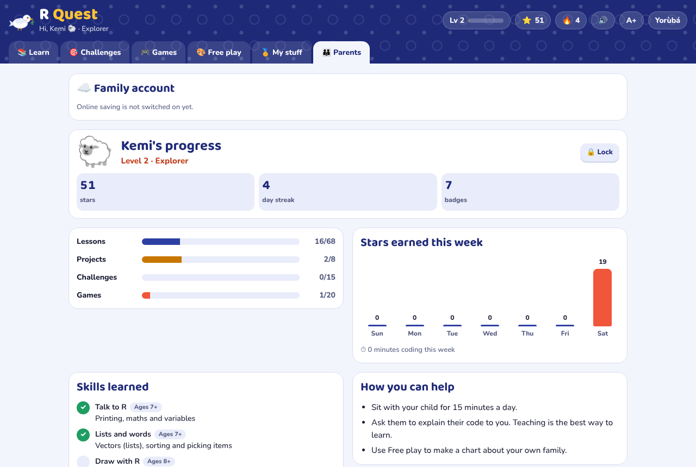
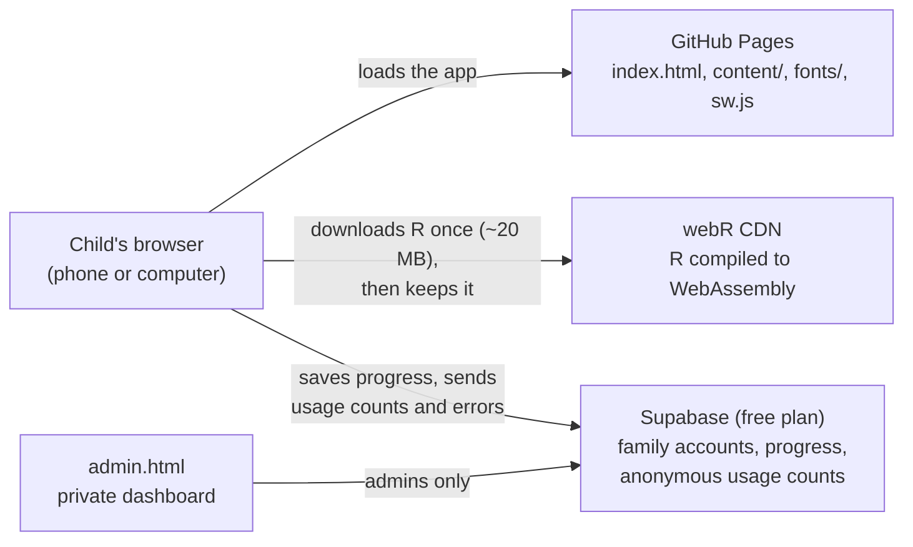

# R Quest 🕊️

**A free, bilingual (English and Yorùbá) R coding playground for children.**
Kids learn real R by drawing charts, playing games, solving puzzles and exploring Bible stories, right in the browser on a phone or computer. Nothing to install.

### ▶ [Open R Quest](https://exelegch.github.io/rquest/)

[](https://github.com/Exelegch/rquest/actions/workflows/test.yml)

<p>
  
  
</p>

---

## What children get

- **A learning path of 8 units for ages 7 to 14:** 36 lessons, 16 exercises, 8 "Fix the bug" puzzles and 8 projects, unlocked one step at a time. Each unit shows a suggested age and what children will learn.
- **Lessons in three steps:** *Try it* (run and change the example), *Predict* (a "What will R print?" question, checked against real R) and *Your turn* (a new mission that R checks). A hint is always there.
- **Fix the bug:** broken code with a clue, so children learn to read R's messages and debug calmly.
- **Projects:** one per unit, with a checklist that ticks itself part by part.
- **Unit 8, Young data scientist (12+):** functions that return answers, building results in loops, `sapply()`, new columns, `tapply()` and charts that tell a story.
- **Every day:** a new daily puzzle with a puzzle streak, and a 60-second speed quiz.
- **Certificates:** a printable certificate with the child's name for every finished unit, and a graduate certificate at the end.
- **15 challenges** that check the answer inside R, labelled Easy, Medium or Hard.
- **20 games** children change by typing or tapping, such as Guess the number, Treasure hunt, Ludo race, Music maker and Bible quiz. Several have Easy, Medium and Hard levels with bonus stars.
- **Real R, really running:** code runs on [webR](https://docs.r-wasm.org/webr/latest/), R compiled for the browser, so charts, loops, data frames and real datasets like `iris` all work.
- **Friendly help:** R's error messages are explained in plain words, there's a 💡 hint on every exercise, and a 🔈 button reads instructions aloud.
- **Phone-first:** a light code editor with a row of symbol keys (`<-`, `( )`, `" "`) and a Blocks mode for beginners.
- **Accessible:** three text sizes, a high-contrast mode, a calm mode with less movement, keyboard support, and automated WCAG 2.1 AA checks on every screen.
- **Motivation:** stars, levels, a daily goal, streaks, 23 badges, confetti, an animated dove mascot, and a gallery of saved drawings.
- **Culture and faith:** Nigerian examples (market prices in Naira, jollof votes, adire cloth, Ludo) and Bible activities (memory verses, Noah's ark, the feeding of the 5,000). Verses are from the King James Version.
- **Two languages:** every screen, lesson and hint is in English and Yorùbá. R code itself stays in English.

<p>
  
  
</p>
<p>
  
  
</p>

## What parents get

- **A parent page** behind a simple sum, so children don't wander in. It shows progress, stars this week, minutes spent coding, skills learned, and tips for helping.
- **Family accounts:** a grown-up signs in once with an email. Each child is only a first name and an animal picture. Progress follows the child to any phone or computer, and if a child uses two devices before they sync, the progress is combined, never overwritten.
- **Control of their data:** a [privacy notice](https://exelegch.github.io/rquest/privacy.html) in English and Yorùbá, a switch to stop anonymous usage counts, and buttons to delete the data on a device or the whole family account.
- **A free [teacher's guide (PDF)](docs/teacher-guide.pdf)** with unit outcomes and ages, a 45-minute session plan, unplugged warm-ups, Bible connections and links to the CSTA computing standards.
- **A 💬 feedback button** on every activity.



## Curriculum

| Unit | Ages | Lessons | Exercises | Fix the bug | Project |
|---|---|---|---|---|---|
| 1. Talk to R *(Bá R sọ̀rọ̀)* | 7+ | Say hello, Super calculator, Variables | Minutes in a day, My age box | Missing bracket | All about me |
| 2. Lists and words *(Àkọsílẹ̀ àti ọ̀rọ̀)* | 7+ | Make a list, Words too!, Math on lists, Sorting, Pick from a list | Five friends, Top score | Lost comma | My test scores |
| 3. Draw with R *(Ya àwòrán pẹ̀lú R)* | 8+ | Draw dots, Bar chart, Pie chart, Line chart | My own bar chart, Growing bean | Mystery colour | Family favourites |
| 4. Decisions and loops *(Ìpinnu àti ìyípo)* | 9+ | TRUE or FALSE, If / else, Loops, While loops, Functions, Random stuff | Pass or try again, Seven times table | Capital trouble | Times table machine |
| 5. R in real life *(R nínú ayé gidi)* | 9+ | Market day, Piggy bank, Twelve baskets | Shopping total, The four Gospels | Wrong column | My mini shop |
| 6. Words and text *(Ọ̀rọ̀ àti lẹ́tà)* | 9+ | Glue words, Big and small letters, Cut words up, Backwards words | Shout it out, How long is my name? | Lost quote marks | My name poster |
| 7. Data detective *(Aṣàwárí dátà)* | 10+ | Meet a dataset, Count and average, Histogram, Compare groups, Sort a table | Average sepal, Longest petal | Small letter, big problem | Weather detective |
| 8. Young data scientist *(Onímọ̀ dátà ọ̀dọ́)* | 12+ | Functions that give back, Build a list in a loop, Do it to every item, New columns, Group and summarise, Tell a story with a chart | Grade machine, Hottest month | Missing piece | Rain report |

**Daily puzzles:** 14 short puzzles that rotate, one per day (How many legs?, Countdown, Six days and a rest ✝, Coin jar and more).

**Challenges:** Print your name, Make 100, Make it blue, Count to ten, Three colours, Big average, Giant dots, Say it 3 times, Days of creation, Doubling machine, Big and small, Line it up, Even numbers, Jollof wins, Saving ₦10,000.

**Games:** Guess the number, Rock Paper Scissors, Dice roller, Ludo race, Treasure hunt, A verse for you ✝, Coin flip, Silly story, Memory verse ✝, Secret code, Spiral art, Flower maths, Heart shape ✝, Starry night ✝, Noah's rainbow ✝, Adire cloth, Bible book finder ✝, Two by two ✝, Bible quiz ✝, Music maker ✝.

---

## How it works



- **The app** is `index.html` plus two content files in `content/`. There's no build step and no server to run.
- **Fonts are stored with the app,** so children's browsers never contact Google Fonts.
- **R runs on each child's device.** The server never runs code, so it costs nothing however many children use it.
- **Saving:** progress is always saved on the device first. With a family account it also syncs to Supabase a couple of seconds after each activity, and catches up after being offline.
- **Saving data on mobile plans:** a service worker keeps the app and the 20 MB R engine on the device after the first visit. R still needs a connection to start; offline, the app opens and says so, then starts R when the connection returns.

## Repository layout

| Path | What it is |
|---|---|
| `index.html` | The app: the first 30 lessons, exercises, challenges, games, styles and code |
| `content/lesson-steps.js` | The Predict question and Your-turn mission for every lesson |
| `content/new-activities.js` | Fix-the-bug puzzles, projects, unit 8, daily puzzles, unit ages and outcomes |
| `admin.html` | Private usage dashboard (admins only) |
| `privacy.html` | The privacy notice, in English and Yorùbá |
| `fonts/` | Self-hosted fonts (SIL Open Font License) |
| `sw.js`, `manifest.webmanifest`, `icons/` | Offline support and "add to home screen" |
| `supabase/001_family_accounts.sql` | Family accounts, children and their privacy rules |
| `supabase/002_usage_monitoring.sql` | Anonymous usage events, error reports, admin access |
| `supabase/003_rate_limits.sql` | Limits that stop anyone flooding the database, and automatic clean-up |
| `supabase/004_all_time_totals.sql` | All-time running totals on the dashboard; usage is kept for good |
| `supabase/005_feedback_and_privacy.sql` | Feedback, "delete our family account", totals for the new activities |
| `docs/teacher-guide.pdf` | The guide for teachers and parents (built from `docs/teacher-guide.template.html`) |
| `docs/yoruba-review.csv`, `docs/TRANSLATING.md` | Every English and Yorùbá text side by side, and how to suggest a better word |
| `tests/` | Automated browser tests (Playwright and axe-core) |
| `tools/` | Rebuilds the screenshots, the teacher's guide and the Yorùbá review sheet |
| `.github/workflows/` | Tests, keep-Supabase-awake, weekly encrypted backup |

## Running it yourself

```bash
npm install
npm start            # serves the app at http://localhost:8080
npm test             # runs every test in a real browser with real R
npm run guide        # rebuilds docs/teacher-guide.pdf
npm run yoruba       # rebuilds docs/yoruba-review.csv
```

The tests use a pretend Supabase, so they never touch real data. The content test opens every activity in real R: every lesson must run, every Predict answer must be exactly what R prints, and every mission, exercise, bug fix, project and daily puzzle must reject its starter but accept its answer. It also fails if any text is missing its Yorùbá. The accessibility test runs axe-core's WCAG 2.1 A and AA checks on every screen and pop-up.

## Setting up Supabase (one time)

1. **Create the project:** create a free project at [supabase.com](https://supabase.com).
2. **Create the tables:** in **SQL Editor**, run `supabase/001_family_accounts.sql`, then `supabase/002_usage_monitoring.sql`, then `supabase/003_rate_limits.sql`, then `supabase/004_all_time_totals.sql`, then `supabase/005_feedback_and_privacy.sql`.
3. **Connect the app:** in **Project Settings → API**, copy the **Project URL** and the **publishable** key into `CLOUD_CONFIG` in `index.html`. Both are safe to publish, because row-level security keeps each family's data private. Never put the secret key in this repository.
4. **Point sign-in emails at the site:** in **Authentication → URL Configuration**, set **Site URL** to `https://exelegch.github.io/rquest/` and add `https://exelegch.github.io/rquest/**` under **Redirect URLs**.
5. **Make yourself an admin:** sign up in the app, then run this in SQL Editor, using your email:
   ```sql
   insert into public.admins (user_id) select id from auth.users where email = 'you@example.com';
   ```
6. **Open the dashboard** at [`/admin.html`](https://exelegch.github.io/rquest/admin.html).

### The usage dashboard

`admin.html` shows:
- running totals since R Quest started: learners ever, activities, lessons, exercises, challenges, games, families
- learners today and over the last 7, 30 or 90 days, the last year, or all time
- activities finished each day
- how many children use Yorùbá
- family and child counts
- **where children get stuck:** each lesson's "not yet" answers and code errors, flagged when most attempts go wrong
- **error reports** sent by the app itself, with the browser and app version
- **feedback** from the 💬 button: how children felt (fun, too hard, too easy, confusing, broken) and their messages
- projects, bug fixes, daily puzzles and speed quizzes

Counts come from a random device id with no names, so one child on two phones counts twice.

### GitHub Actions

| Workflow | When | What it needs |
|---|---|---|
| **Tests** | Every push and pull request | Nothing |
| **Keep Supabase awake** | Every 3 days | Nothing. It reads the public key from `index.html`. Free projects pause after a week without activity, which would stop sign-in. |
| **Weekly database backup** | Sundays | Two repository secrets: `SUPABASE_DB_URL` (Supabase → **Connect** → *Session pooler* string, with your database password) and `BACKUP_PASSPHRASE`. Backups are encrypted, because this repository is public. To open one: `gpg --decrypt rquest-backup-DATE.sql.gpg > backup.sql`. |

## Adding a lesson or exercise

New lessons go in `ADVANCED` in `content/new-activities.js` (or a new file like it). A lesson looks like this:

```js
{ id: 'L37', icon: '🌍', title: 'My new lesson', title_yo: 'Ẹ̀kọ́ tuntun mi',
  prompt: 'What the child should try.', prompt_yo: 'Ohun tí ọmọ náà yóò gbìyànjú.',
  code: `print("Hello")` },
```

Every lesson also needs its two extra steps, keyed by the lesson id (see `content/lesson-steps.js`):

```js
L37: {
  quiz: { code: `nchar("Ada")`, options: ['[1] 3', '[1] "Ada"', '[1] 1'], answer: 0,
          why: 'nchar() counts letters.', why_yo: '…' },
  mission: { text: 'Count the letters in your own name.', text_yo: '…',
             goal: 'Uses nchar()', goal_yo: '…', hint: 'nchar("Bisi")',
             check: (out, code) => /nchar\s*\(/.test(code) },
},
```

The Predict options must be exactly what R prints, and the mission must reject the lesson code and accept the lesson code plus the hint. The tests check both.

An exercise adds `exercise: true`, `points`, a `goal`, a `hint` (the hint must be a working answer when added below the `starter`), and a check. There are two kinds of check:
- `check(out, code, ctx)` looks at R's printed output and the child's code.
- `rcheck` is an R expression that must return `TRUE`.

A bug fix adds `fix: true`, a `clue`, and a `hint` that is the whole fixed program. A project has `project: true` and a list of `parts`, each with its own `check` or `rcheck`.

Then add the new `id` to a unit's `ids` list (`UNITS` in `index.html`, or `UNIT_INFO` in `content/new-activities.js`), and run `npm test`.

- **Ids:** lessons start with `L`, exercises `E`, bug fixes `B`, projects `P`, daily puzzles `D`, challenges `C`, games `G`, and Free-play pages `F`. Never reuse or renumber an id, because children's saved progress refers to it.
- **Pretend numbers:** mark content that uses made-up numbers with `pretend: true`.
- **Bible content:** mark it with `bible: true`.

## Security and limits

- **Public key:** the key in `index.html` is Supabase's public *publishable* key. It's meant to be visible. Row-level security decides what each request may read or write.
- **Families:** a family can only see and change its own children, and can have at most 10. A signed-in parent can delete their own account, which deletes every child and all their progress with it.
- **Feedback:** the app removes email addresses and phone numbers from messages before sending. The database keeps at most 10 per device per hour and 300 per hour in total, and deletes feedback after a year.
- **Usage counts and error reports:** the app can add them but can't read them back. The database quietly drops anything above 300 events or 20 error reports per device per hour, and above 20,000 events or 1,000 reports per hour in total, so nobody can fill the free plan on purpose. Usage events are kept for good so the all-time totals never go down (each is about 100 bytes, so even a million fit easily in the free plan); error reports are deleted after 90 days.
- **Copies:** online saving switches itself off when a copy of the app runs at another address with the official Supabase project still in `CLOUD_CONFIG`.

## Running your own copy

You're welcome to run R Quest for your school, church or community, within the licence terms below.
1. **Fork the repository** and turn on GitHub Pages for your fork.
2. **Use your own Supabase project.** Create a free one, run the files in `supabase/` in order, and put your own project URL and publishable key in `CLOUD_CONFIG` in `index.html`. Until you do, online saving stays switched off on your copy, and lessons still work with progress saved on each device.
3. **Write your own privacy notice.** Edit `privacy.html` with your name and contact details: you are responsible for the data your copy collects.
4. **Keep the credit** to R Quest and the link to the source code, and share your changes under the same licences.

## Privacy

- **The notice:** [privacy.html](https://exelegch.github.io/rquest/privacy.html), in English and Yorùbá, explains what is collected, why, for how long, and how to delete it. It follows the principles of Nigeria's Data Protection Act 2023, GDPR and COPPA.
- **What's stored:** without an account, nothing about the child leaves the device except anonymous usage counts. With a family account: a parent's email, and each child's first name, animal picture and progress. Usage counts, error reports and feedback never include names.
- **How it's protected:** every table uses row-level security, so a family can only see its own children, and only admins can read usage counts and feedback.
- **Families are in control:** they can switch off usage counts, delete a device's data, or delete the whole family account, all from the Parents page.

## Credits

- [webR](https://docs.r-wasm.org/webr/latest/) by the R Consortium / Posit team
- [Supabase](https://supabase.com)
- Fonts: Baloo 2, Nunito and JetBrains Mono (SIL Open Font License), served from this repository via [Fontsource](https://fontsource.org); see `fonts/LICENSES.md`
- Accessibility checks: [axe-core](https://github.com/dequelabs/axe-core)
- Bible verses from the King James Version (public domain)

## License

R Quest is © 2026 Olatunde Akanbi.

- **Code** (the app, dashboard, service worker, SQL, tests and tools) is licensed under the [GNU Affero General Public License v3.0 or later](LICENSE). You may use, change and share it, but if you run a changed version for others, including as a website, you must offer them your source code under the same licence and keep the credit.
- **Educational content** (lesson, exercise, challenge and game texts and their example R code, hints, English and Yorùbá translations, the dove mascot, icons and screenshots) is licensed under [Creative Commons Attribution-NonCommercial-ShareAlike 4.0](LICENSE-CONTENT). You may share and adapt it for non-commercial purposes with credit, under the same licence.
- **Which licence covers what** is summarised in [NOTICE](NOTICE).
- **Earlier versions:** versions published before 16 October 2026 (up to commit `1339b21`) were released under the MIT licence, and copies made from those versions keep it.
- **Third-party parts:** Bible verses are from the King James Version (public domain). webR, Supabase and the fonts keep their own licences.
